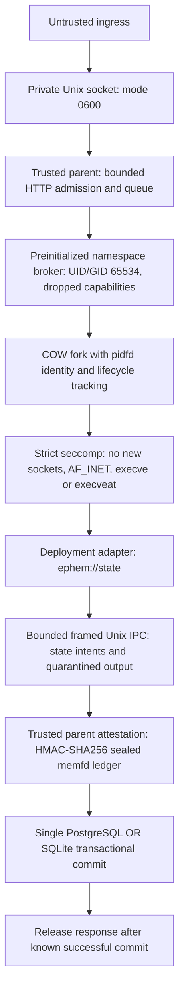

# EPHEM: Ephemeral Zero-Persistence Runtime (Phase 3)

Mitigating deployment lag via COW worker isolation & pre-commit attestation gates; retained native p95: 0.52ms.


-blue)

**Recorded release-alignment native lifecycle p95: 0.52ms (0.520076ms measured). Zero corrupted keys committed in the tested fatal-fault fixtures. Production: HOLD.**

**Remote-sync reproduction: PHP latency gate FAIL.** On the integrated checkout,
the signed paired PHP delta p95 was **3.730803ms**, exceeding the <2.0ms gate;
the reproduction script exited 1. Functional checks passed with zero corrupted
keys in the SQLite fixture. See [the integration precheck](reports/phase3/REMOTE_SYNC_PRECHECK.json)
and [the separate results below](#verified-empirical-results). The 0.52ms headline
is a retained native measurement from the release-alignment run.

EPHEM runs each request in a fresh copy-on-write worker and quarantines its state
changes and response until the trusted parent verifies its lifecycle and sealed
ledger. The verified scope is a single execution lane, a warmed PHP NTS embed
adapter, bounded state commands and one SQLite or PostgreSQL versioned KV table.
It is an experimental mitigation for deployment lag; upstream vendor patching
and application qualification remain necessary.

The badge describes retained engineering verification, not an independent audit
or certification. Results below come from [the Phase 3 report](docs/EPHEM_PHASE3.md),
[the release-alignment rerun](reports/phase3/RELEASE_ALIGNMENT.json) and
[the original validation verdict](reports/phase3/VALIDATION.json), dated **2026-10-23 KST**.
Test host: Linux aarch64, kernel 6.8.0-146-generic, Rust 1.99.1,
PHP 8.3.6 NTS embed. PostgreSQL 16.15 was tested in the original validation;
PostgreSQL and BPF were **UNRUN in the release-alignment invocation**.
The supplied independent-host x86_64 native run is now retained and checked
below. Its PHP adapter, live PostgreSQL and BPF LSM paths remain **UNRUN**.

## Architecture



The namespace broker drops supplementary groups and all user/group IDs to
`65534`; it is distinct from the trusted parent, which owns the backend and
sealing key. The implementation uses `fork()` and pidfds. Each worker inherits
only the bounded IPC capabilities needed for the request. The state adapter
accepts GET, SET, SETEX, DEL, INCR, PING and QUIT; it forwards no arbitrary SQL.
No worker receives a DB credential or raw network capability.

The trusted parent requires matching worker identity, exit 0, no signal,
complete IPC, a valid immutable ledger and an unexpired decision before commit.
Fatal faults burn staged mutations and withhold worker output. A lost or timed-out
PostgreSQL COMMIT acknowledgment is **indeterminate**: HTTP 500,
`committed_mutations=null`, adapter quarantine and no automatic retry. It cannot
truthfully be reported as zero committed mutations.

## Verified empirical results

### Verified cross-architecture native reproduction

The supplied [x86_64 report](evidence/x86-independent-v1/X86_REPRODUCTION.json)
records a different host at source commit
`1320713d065f04ae701026e14edf46226e71af6d`. Stored-record verification recomputes
all 1,000 samples after 100 reported warmups and checks all 13 lifecycle cases
and 23 retained worker receipts. This ingestion executes no Linux worker.
Values below preserve the JSON numbers without rounding; each row is a
separate run, with nearest-rank percentiles and startup excluded.

| Architecture | Recorded host / run | Native p50 (ms) | Native p95 (ms) | Native p99 (ms) | Native max (ms) | p95 <2.0ms |
| :--- | :--- | ---: | ---: | ---: | ---: | :---: |
| ARM64 (aarch64) | Same-host VM, kernel 6.8.0-146-generic; original validation | 0.448963 | 0.684507 | 0.916343 | 1.383182 | PASS |
| ARM64 (aarch64) | Same-host VM, kernel 6.8.0-146-generic; release alignment | 0.408537 | 0.520076 | 0.5900340000000001 | 0.9285720000000001 | PASS |
| ARM64 (aarch64) | Same-host VM, kernel 6.8.0-146-generic; separate remote-sync command | 0.610938 | 1.4441330000000001 | 2.111405 | 3.505912 | PASS |
| x86_64 | Supplied independent-host report, kernel 6.18.44-fc-v140 | 0.44322300000000003 | **0.593124** | 0.7238249999999999 | 1.8941999999999999 | PASS |

The x86 cargo logs record 21 tests passed and one ignored real-PostgreSQL test,
plus successful release builds. The native receipts record eight classic
seccomp SIGSYS denials and clean recoveries, alongside COW reset, SIGSEGV,
timeout, verifier rejection and truncated state IPC checks. Binary hashes are
recorded; the x86 binaries themselves were not supplied for byte verification.
Detailed CPU/VM/load metadata and the complete invocation transcript are
unrecorded. These observations establish bounded native fixture compatibility;
they do not establish matched host performance, complete PHP reproduction or
production parity. **Production remains HOLD.** The x86 PHP HTTP path, full
reproduction checker, live PostgreSQL and BPF LSM remain **UNRUN**.

```sh
python3 scripts/verify_stored_evidence.py
python3 scripts/verify_x86_evidence.py
```

The first command preserves the historical four-report snapshot, including
the PHP latency FAIL and its original local x86 UNRUN field. The second checks
the newly supplied x86 records separately. See the [ingestion audit](docs/audit/INGESTION_20261023.md)
for archive identities, corrections to the handoff examples and remaining gaps.

The remote-sync integration check preserved the public `ephem-gate` 0.2.0 source
and passed workspace format, clippy with warnings denied, 21 unit tests and release
builds. Its reproduction script **failed the PHP paired-latency gate**:

| Remote-sync PHP check | Observed result |
| :--- | :--- |
| Complete contained PHP HTTP p95 | 18.569558ms |
| Uncontained Python/PHP baseline p95 | 29.886462ms |
| Signed matched PHP delta p95 / maximum | **3.730803ms / 14.267238ms; p95 gate FAIL** |
| Functional status | PASS; 100 initial clean requests, 232 distinct workers, zero corrupted committed keys |
| Reproduction script | Exit 1; stopped before the native stage |

After the PHP failure, a separate native invocation ran 1000 samples after
100 warmups and passed the lifecycle checks and native p95 <2.0ms gate:

| Separate remote-sync native run | p50 (ms) | p95 (ms) | p99 (ms) | max (ms) |
| :--- | ---: | ---: | ---: | ---: |
| Warm native lifecycle | 0.610938 | **1.444133** | 2.111405 | 3.505912 |

The paired delta is computed from matched request differences, not by
subtracting the two route percentiles. The three rebuilt runtime binaries
matched the original validation SHA-256 hashes. The failed latency result is
retained in [the remote-sync precheck](reports/phase3/REMOTE_SYNC_PRECHECK.json)
and [its raw run directory](reports/phase3/remote-sync-run/); it is not a new
end-to-end reproduction PASS. The separate native PASS does not erase the PHP
latency FAIL. No PHP retry was performed. **Production remains HOLD.**

The release-alignment run retained fresh raw samples and receipts. It
reran the native lifecycle and SQLite PHP paths; it did not rerun PostgreSQL
or BPF enforcement.

| Metric / event | p50 (ms) | p95 (ms) | p99 (ms) | Observed status |
| :--- | ---: | ---: | ---: | :--- |
| Native warm worker lifecycle, 1000 samples after 100 warmups | 0.408537 | **0.520076** | 0.590034 | PASS, native p95 <2.0ms gate |
| Complete contained PHP HTTP, 100 measured pairs | 2.076555 | 3.316038 | 3.658867 | Functional PASS; separate event from native lifecycle |
| Signed matched PHP delta | -1.510438 | -0.350578 | 0.543993 | PASS, bounded comparison p95 <2.0ms |
| Five PHP faults: SIGSEGV, SIGSYS, nonzero exit, deadline, verifier rejection | — | — | — | **0 corrupted keys committed** in the SQLite fixture, HTTP 500 and clean recovery |

The release-alignment native maximum was **0.928572ms**. The earlier validation below is
retained separately, including its 0.684507ms native p95; neither run is a
production tail bound. The difference between those two observations does not
establish a measured performance improvement.

| Original validation event | p50 (ms) | p95 (ms) | p99 (ms) | Observed status |
| :--- | ---: | ---: | ---: | :--- |
| Native warm worker lifecycle, 1000 samples after 100 warmups | 0.448963 | 0.684507 | 0.916343 | Retained original PASS |
| Complete contained PHP HTTP, 100 measured pairs | 2.205190 | 2.739029 | 3.486328 | Retained original functional PASS |
| Uncontained Python/PHP baseline, same original paired run | 3.915000 | 5.130096 | 5.421015 | Reference |
| Signed matched PHP delta | -1.703809 | -0.941094 | -0.652507 | Retained original bounded comparison PASS |
| Actual paused PostgreSQL backend read | — | — | — | HTTP 500 in 106.746544ms; quarantined next request in 1.597850ms |

Native lifecycle includes dispatch, fork, seccomp, state round trip, private
scratch-page discard, output EOF and reaping; startup is excluded. HTTP timing
includes connection through complete response EOF. The paired PHP run excludes
20 warmup pairs, randomizes order with seed 20261023, uses nearest-rank
percentiles and retains all samples. The Python baseline opens SQLite per
request while the Rust parent keeps its connection. This confounds an isolated
overhead estimate: a negative delta does not establish universal <2ms switching
cost or stock PHP-FPM performance. Throughput and production tails are
**UNMEASURED**.

The release-alignment run passed 18 workspace unit tests and 12 reproduction
checker regression tests. Original retained checks include a separately
executed real PostgreSQL adapter fixture, 100 initial clean requests on each
backend, namespace/seccomp probes, fault recovery and build provenance. The
five PHP faults are separate from the paused-PostgreSQL test. The original
SQLite and PostgreSQL runs both recorded zero corrupted keys; this is evidence
for these fixtures, not proof against every possible corruption.

## Why production status is HOLD

- **No universal `S_in=0`.** The unchanged compatible fixture still requires
  the execution host, PHP embed/bootstrap adapter, `ephem://state` protocol and
  fixed KV schema. Raw SQL/PDO/mysqli and native Redis clients are unsupported.
- **Response-channel exfiltration remains possible.** Output is withheld until
  exit verification and commit, but a clean request can include any secret it
  can read in a valid response. Process disposal and lifecycle checks do not
  determine whether those response bytes disclose sensitive data.
- **Silent corruption is outside the proof.** Exit 0 is lifecycle evidence,
  not memory-integrity evidence. Corruption that emits valid allowed commands
  and exits cleanly can commit. The gate does not authorize business intent.
- **BPF LSM enforcement is UNRUN (exit 77).** `bpf` was absent from the tested
  kernel's active LSM list. C/BPF compilation passed; the Rust daemon does not
  enroll/load the optional policy. The executed policy uses mandatory
  namespaces and classic seccomp. See [BPF scope and self-test](bpf/WARM_CONTAINMENT.md).
- **Commit and integration limits remain.** One backend commits per request;
  SQL plus Redis atomicity is absent. In-flight durable commits cannot be
  retroactively undone, response loss may follow commit, and DB WAL/journal
  bytes may reach storage. Real lost-COMMIT-ACK network injection is **UNRUN**.
  FastCGI, Node.js, WSGI, load qualification and production rollout are unverified.

## Quickstart and reproduction

Use a **dedicated Linux VM** with x86_64 or aarch64, kernel >=5.12, procfs,
root namespace/mount permissions, cgroup v2, Rust/Cargo, a C compiler (`cc`),
Python 3, PHP 8.3 NTS development headers and `libphp8.3-embed`.
`PHP_CONFIG` defaults to `php-config8.3`. The cgroup v2 check is a host
prerequisite; it does not assert that this Phase 3 runtime enforces cgroup limits.
Run only the supplied trusted fixture: the baseline is uncontained.

```bash
git clone https://github.com/testofschool/ephem.git
cd ephem
# Authenticate sudo first if not running as root; keep Cargo on your user PATH.
sudo -v
./scripts/reproduce_phase3.sh --check
./scripts/reproduce_phase3.sh
```

The script checks prerequisites, runs `cargo test --locked --workspace`, builds
the release workspace and tested deliverable feature set, compiles the C
adapter, runs the SQLite PHP harness with `--require-p95`, then runs:

```bash
./target/release/ephem-warm-pool --root <fresh-root-owned-rootfs> \
  --iterations 1000 --warmup 100 --lifecycle-check --require-p95-ms 2
```

Every invocation retains fresh evidence under `/tmp/ephem-phase3.XXXXXXXX/`,
including failed runs. The final checker recomputes raw-sample percentiles,
verifies lifecycle/fault invariants against `VALIDATION.json` and prints actual
new measurements beside the original retained reference. The 0.520076ms
release-alignment result and original 0.684507ms result are observations; a
new run need not reproduce either exactly. The native gate is **p95 <2.0ms**. A failure exits nonzero;
missing prerequisites exit **77 / UNRUN**, never PASS.

This one-click path reruns **SQLite PHP and native lifecycle**. Live PostgreSQL,
paused-backend and optional BPF tests are **UNRUN in that invocation**. Their
retained results stay separately labeled. See [full Phase 3 commands and
measurement definitions](docs/EPHEM_PHASE3.md#reproduce-in-a-dedicated-linux-vm)
and [the local Linux lab guide](docs/LINUX_LAB.md) for separate execution.

## Release preparation and community checks

```bash
./scripts/bundle_release.sh
# Inspect the printed staging directory, archive and SHA256SUMS.txt.
# Run the printed gh release command only when publication is intended.

./scripts/seed_issues.sh
# Review .github/ISSUE_SEEDS/; explicit posting:
./scripts/seed_issues.sh --post
```

The bundler checks measured binary hashes, gathers evidence and release notes,
and prints a `gh release create v0.3.0-stateful-alpha` command. It does not
publish a release. The issue script prints commands by default; `--post`
creates the three reviewed technical requests using GitHub CLI. The seeds
cover [BPF LSM verification](.github/ISSUE_SEEDS/issue_1_bpf_lsm.md),
[heterogeneous transaction semantics](.github/ISSUE_SEEDS/issue_2_hybrid_atomicity.md)
and [x86_64 parity](.github/ISSUE_SEEDS/issue_3_x86_parity.md).

## Evidence index and earlier work

| Evidence | What it records |
| :--- | :--- |
| [Independent x86_64 evidence](evidence/x86-independent-v1/) | Supplied raw native samples, lifecycle receipts, cargo logs, environment and recorded binary hashes; native p95 0.593124ms |
| [Evidence ingestion audit](docs/audit/INGESTION_20261023.md) | Verified ingestion scope, original archive hashes and outstanding x86 qualification gaps |
| [Preserved audit snapshot](docs/audit/INDEPENDENT_AUDIT_20261023.md) | Historical stored-record and scope review at source commit 1320713; not a new security audit |
| [REMOTE_SYNC_PRECHECK.json](reports/phase3/REMOTE_SYNC_PRECHECK.json) | Integrated-tree checks and PHP latency-gate FAIL; separate from retained release-alignment results |
| [Remote-sync raw run](reports/phase3/remote-sync-run/) | Integrated-checkout reproduction evidence, including the failed PHP timing gate |
| [RELEASE_ALIGNMENT.json](reports/phase3/RELEASE_ALIGNMENT.json) | Retained 0.520076ms native p95, SQLite rerun, reproduction checks and invocation limits |
| [Release-alignment native run](reports/phase3/release-alignment-final/warm-native.json) | Raw samples and lifecycle receipts for the 0.520076ms run |
| [Release-alignment PHP run](reports/phase3/release-alignment-final/stateful-verification.json) | SQLite faults, paired samples and recovery for that invocation |
| [Measured workspace snapshot](reports/phase3/measured-workspace/Cargo.lock) | Lockfile used by the recorded measurements; public gate version metadata is preserved separately |
| [VALIDATION.json](reports/phase3/VALIDATION.json) | Original bounded verdict, 0.684507ms native p95, binary hashes and unmet requirements |
| [EPHEM_PHASE3.md](docs/EPHEM_PHASE3.md) | Architecture, integration contract, decisions and measurement caveats |
| [SQLite run](reports/phase3/stateful-isolation-final.json) | PHP faults, receipts and randomized paired samples |
| [PostgreSQL run](reports/phase3/postgres-http-final.json) | Single-backend faults, recovery and paused-backend observations |
| [Native lifecycle](reports/phase3/warm-native-deliverable-final.json) | Raw samples, seccomp probes and COW lifecycle receipts |
| [Provenance](reports/phase3/provenance-final.json) | Exact final source/build provenance |
| [Earlier public README](README.v0.2.md) | Preserved v0.2 runtime, threat-model and evidence entry points |

The first compilation/integration failures and earlier tail measurements remain
in `reports/phase3/`. No failure or unavailable test is rounded into a pass.
