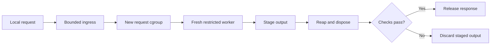

# EPHEM

[](https://github.com/testofschool/ephem/actions/workflows/ci.yml)
[](LICENSE)

**One request. One disposable worker.**

A small Linux runtime for giving compatible CGI and CLI programs a fresh, restricted execution environment for every request.

[How it works](#how-it-works) · [Quick start](#quick-start) · [Threat model](docs/THREAT_MODEL.md) · [Evidence](evidence/RESULTS.md) · [Roadmap](docs/ROADMAP.md)


> **Experimental — production qualification remains on HOLD.** Read the [threat model](docs/THREAT_MODEL.md) before running a workload. The illustration above is a visual metaphor; executed checks belong in [the evidence record](evidence/RESULTS.md).

## Why EPHEM?

A request ends. Its process often stays alive.

That process can retain temporary files, application state and data from earlier requests. EPHEM explores a stricter contract: start a fresh worker, restrict its direct effects, collect bounded output, and dispose of its execution scope before releasing a successful response.

The first target is a narrow class of existing Linux programs: one bounded input, one bounded output, no direct networking and no durable writes. An offline parser or a read-only CGI handler can fit this model. Each real application still needs a compatibility check.

## How it works



The Rust gate accepts one `POST /run HTTP/1.1` request per Unix-socket connection. The C launcher creates new PID, mount, network, IPC and UTS namespaces. Before the worker starts, it drops privileges and capabilities and applies Landlock and a seccomp allowlist.

The worker sees a curated read-only root filesystem and its own temporary `/tmp`. It has no direct network access. The gate owns the output buffer; the worker never receives its descriptor. A successful response requires a clean launcher receipt, bounded output, an empty and removed request cgroup, no recorded cgroup OOM, and completion within the request budget.

| Default | Value |
| --- | --- |
| Input / output | 1 MiB each |
| In-flight requests | 4 |
| Request memory | 128 MiB cgroup limit |
| Request process limit | 2: launcher and worker |
| Request CPU quota | 100 ms per 100 ms period |
| Private scratch filesystem | 16 MiB, 1,024 inodes |
| Request budget | 1,000 ms from admission through successful disposal |

Failure cleanup and response transmission have additional allowances. These defaults are resource controls, not a latency SLA. The request cgroups do not account for the trusted gate's buffers; give the service its own aggregate budget. See [operations](docs/OPERATIONS.md).

## Quick start

Use a **dedicated Linux VM**, with root access, Rust/Cargo, a C compiler with static libc support, and `curl`. The kernel must support the namespaces, Landlock ABI 3 or newer, seccomp notification, pidfds and cgroup v2 controls used by the runtime.

The strict profile requires **no active host swap** and a readable **non-piped `kernel.core_pattern`**. The `cpu`, `memory` and `pids` controllers must already be delegated from the cgroup root. Follow the explicit host setup in [OPERATIONS.md](docs/OPERATIONS.md) first. EPHEM refuses incompatible settings; it does not change host swap or core-dump policy for you.

Build the trusted programs:

```sh
git clone https://github.com/testofschool/ephem.git
cd ephem
cargo build --locked --release
sh packaging/build-jail.sh
```

Create a new demo installation and a synthetic test rootfs. These paths must not belong to an existing workload:

```sh
sudo test ! -e /opt/ephem-demo-bin
sudo install -d -m 0755 /opt/ephem-demo-bin
sudo install -m 0755 target/release/ephem-gate target/ephem-jail /opt/ephem-demo-bin/
sudo sh tests/ephem/build-rootfs.sh /opt/ephem-demo
sudo sh packaging/prepare-cgroup.sh /sys/fs/cgroup/ephem-demo
sudo test ! -e /run/ephem-demo
sudo install -d -m 0700 /run/ephem-demo
```

Start the gate in the foreground:

```sh
sudo /opt/ephem-demo-bin/ephem-gate \
  --socket /run/ephem-demo/gate.sock \
  --jail /opt/ephem-demo-bin/ephem-jail \
  --root /opt/ephem-demo \
  --worker /worker \
  --cgroup-root /sys/fs/cgroup/ephem-demo
```

From another terminal, send a request to the fixture's echo command:

```sh
sudo curl --silent --show-error \
  --unix-socket /run/ephem-demo/gate.sock \
  --header 'Content-Type: application/octet-stream' \
  --data-binary 'ECHO hello from ephem' \
  http://localhost/run
```

The expected body is `hello from ephem`. This exercises a synthetic fixture, not an application-security guarantee. The fixture root also contains an intentionally readable synthetic canary for testing the limits of output confidentiality.

Make the lifetime boundary visible from that second terminal:

```sh
for command in DIRTY CLEAN CRASH CLEAN READSECRET; do
  printf '\n%s → ' "$command"
  sudo curl --silent --show-error --unix-socket /run/ephem-demo/gate.sock \
    --data-binary "$command" http://localhost/run
done
```

`DIRTY` writes a marker in private scratch space; the next `CLEAN` reports
`absent`. `CRASH` prints a canary and faults, but the caller receives only
`execution rejected`. `READSECRET` deliberately returns the readable synthetic
canary successfully: an allowed response is still an information channel.

Press Ctrl+C in the gate terminal to stop admission and drain active work. See the [runbook](docs/OPERATIONS.md) for cleanup, test execution, CGI setup and the stricter packaging entrypoint. Do not install the launcher setuid.

## What this protects — and what it does not

EPHEM aims to stop worker state from being intentionally reused across requests and to deny direct durable filesystem and network effects under its restricted profile. It is a **shared-kernel sandbox**, with a trusted root gate and launcher.

**Clean exit is not data-loss prevention.** A compromised worker can read data supplied to it and return that data in a successful response. A response hash identifies bytes; it does not certify their safety or correctness. Do not place unrelated secrets in the rootfs.

The runtime does not undo database writes, make arbitrary applications stateless, remove the need for patches, or establish resistance to kernel compromise, privileged host observers or physical attacks. Core/swap preflight is not secure physical-memory erasure. Read the full [threat model](docs/THREAT_MODEL.md).

## Compatibility

| Workload | Current contract |
| --- | --- |
| Single-request native CLI | stdin to stdout, compatible syscalls, explicit dependencies |
| CGI | Fixed script and minimal request environment; bounded response parser |
| Stateful application / PHP-FPM replacement | General drop-in compatibility is not established |
| Database, remote API, background work | Outside the offline worker profile |
| Streaming response, WebSocket, chunked request | Unsupported |
| Existing container image | Image-rebuild-free attachment is environment-dependent; rollout is separate work |

The CGI adapter accepts `Status` and `Content-Type`; it does not provide general cookies, session handling or redirect headers. A fresh worker has startup cost, and restrictive policies can reject otherwise valid programs.

## Evidence, not immunity claims

Current commands, environment details, outcomes and raw report paths are recorded in [RESULTS.md](evidence/RESULTS.md). Failed and unexecuted checks must remain visible.

| Verification area | Record |
| --- | --- |
| Worker lifecycle and private temporary state | **12/12** tests on ARM64 and x86-64; **50/50** fresh workers in each run |
| Crash, syscall denial, timeout, output overflow and OOM | Staged output withheld in the named fixture cases on both architectures |
| Cgroup resources, host preflight and cleanup | Actual worker OOM and disposal; **6/6** startup controls on both architectures |
| Existing PHP-CGI source | **4/4** tiny uploads on ARM64, unchanged **963-byte** receiver |
| Successful response carrying readable data | [Limits and positive controls](evidence/RESULTS.md) |
| External independent security audit / production qualification | Outstanding |

Run the unit checks with `cargo test --locked --workspace`. Privileged integration checks require the dedicated-VM procedure in [OPERATIONS.md](docs/OPERATIONS.md). A missing prerequisite or skipped test is not a pass.
Exact commands, retained failures, measurements and source/binary hashes are in
[the evidence record](evidence/RESULTS.md).

## Prior art

**This is not a world-first claim.** Groundhog demonstrated transparent sequential request isolation; nsjail and bubblewrap wrap existing Linux programs; Firecracker, gVisor and Kata provide other isolation boundaries. Disposable environments also have a long history.

EPHEM's focus is a small request-oriented wrapper, a restrictive offline profile and inspectable lifecycle evidence. The [prior-art review](docs/PRIOR_ART.md) compares the mechanisms, limitations and open questions. No comparative speed or security ranking is claimed.

## Project

- [Threat model](docs/THREAT_MODEL.md) — assets, assumptions and exclusions.
- [Operations](docs/OPERATIONS.md) — supported host setup and reproduction.
- [Roadmap](docs/ROADMAP.md) — next engineering gates.
- [Initial source audit](docs/INITIAL_AUDIT.md) — earlier gaps and their provenance.
- [한국어 조사 요약](docs/FINDINGS_KO.md) — 차별화와 남은 보강 과제.
- [Contributing](CONTRIBUTING.md) — development and evidence expectations.
- [Security policy](SECURITY.md) — private vulnerability reporting.

Licensed under [Apache-2.0](LICENSE). Hero illustration [generation provenance](assets/GENERATION.md).
