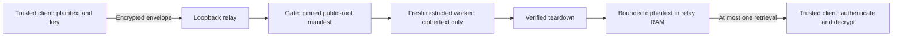

# Zero profile: exclude ambient secrets; transfer ciphertext

This experimental profile combines two distinct controls:

1. A trusted, closed-world root manifest refuses unapproved worker files before the gate binds its socket and again before every worker launch.
2. An optional loopback relay accepts only encrypted envelopes. A separately installed client encrypts and decrypts locally; the relay and worker receive neither its plaintext nor its decryption key.

The manifest control is useful for compatible offline workers. The relay is a deliberately narrower encrypted transfer workload. It cannot run arbitrary existing plaintext applications while keeping their plaintext invisible to those applications. Production qualification remains on HOLD.

## Data and trust boundaries



The client uses AES-256-GCM with a random key and nonce. Its key file stays on the client filesystem. The envelope schema has no key field, and the server has no decryption endpoint. Install and review `zero/client.mjs` and its local dependency `zero/envelope.mjs` independently of the server; a compromised server must not supply the client code you trust with a key.

The relay binds only `127.0.0.1`. Use a trusted SSH tunnel for a separate client machine. There is no public service deployment, account system, recipient key exchange or general authentication layer here. The receipt is a bearer retrieval capability: protect it and the transport. The service can observe ciphertext, sizes, timing and retrieval tokens; compromise can expose those or deny service. Client-side authenticated decryption detects ciphertext tampering, but it does not make the server available or prevent every replay of an otherwise valid encrypted envelope.

The relay holds bounded ciphertext in RAM: 16 objects by default, an 8 MiB aggregate cap, and a default 30-second TTL with a maximum of 60 seconds. Expired tokens are rejected on access; periodic cleanup removes expired entries. A successful claim consumes the object before sending its response, so a failed network delivery can lose it. This is at-most-once retrieval, not guaranteed delivery. Restart does not restore objects from durable storage.

Buffer clearing and dropping references are best-effort retention controls. Node/V8 copies, garbage collection, kernel buffers, snapshots, privileged observers and physical memory remnants are outside a secure-erasure guarantee. The relay, Rust gate, C launcher, trusted root provisioning, host and shared Linux kernel remain part of the trusted computing base. Continue patching them.

## Exact public-root policy

`ephem-gate --root-manifest /trusted/external/manifest.json` enables the stricter root profile. Omitting the flag selects the historical generic offline mode. The named wrapper `packaging/zero-entrypoint.sh` requires `EPHEM_ROOT_MANIFEST`; it fails instead of silently falling back.

Version 1 manifests contain an exact path inventory with entry kind, mode, byte length and SHA-256. The validator rejects missing, additional or changed entries; noncanonical or duplicate paths; unknown schema fields; symlinks, hardlinks and special files; nested mounts; inappropriate ownership or permissions; and changes to the pinned manifest after startup. Manifest ancestry and the worker root must be root-owned and unavailable for group/world writes. The underlying `/tmp` directory is the explicit mode-1777 exception and must contain no manifest children; each worker receives its own tmpfs there.

The preparation helper accepts **one explicit, reviewed static 64-bit ELF worker** and builds a new root containing only `/worker`, an empty `/app` and `/tmp`. It never scans and automatically approves an arbitrary application root. Dynamic interpreters and libraries are outside this minimal builder's contract. The general runtime's CGI support is a separate compatibility path.

A manifest proves approved byte identity. It cannot determine whether an approved executable contains embedded credentials or whether its outputs are authorized. Review the worker's source/build inputs and keep the administrative root immutable while serving. Concurrent hostile root administration is outside the model; per-request hashing is not an atomic filesystem snapshot.

For an explicitly reviewed static worker, build a new root and external manifest in trusted ancestry. Replace the worker placeholder with its real root-owned canonical path. Both output paths must be absent:

```sh
sudo python3 packaging/build-minimal-root.py \
  --worker /absolute/path/to/reviewed-static-worker \
  --root /opt/ephem-public-workload \
  --manifest /opt/ephem-public-workload-manifest.json
```

Launch using the existing [entrypoint variables](../packaging/entrypoint.sh), adding `EPHEM_ROOT_MANIFEST` and invoking `packaging/zero-entrypoint.sh`. The gate/jail binaries, root, manifest, socket ancestry and cgroup domain must already be staged and owned as required by [OPERATIONS.md](OPERATIONS.md). This command does not install a service or prepare its host.

For example, with trusted binaries and wrappers already installed under `/opt/ephem-zero-lab-v1`, a new `/run/ephem-public` socket directory, and a new prepared `/sys/fs/cgroup/ephem-public` domain:

```sh
sudo env -i PATH=/usr/sbin:/usr/bin:/sbin:/bin LANG=C \
  EPHEM_GATE=/opt/ephem-zero-lab-v1/bin/ephem-gate \
  EPHEM_JAIL=/opt/ephem-zero-lab-v1/bin/ephem-jail \
  EPHEM_ROOT=/opt/ephem-public-workload EPHEM_WORKER=/worker \
  EPHEM_ROOT_MANIFEST=/opt/ephem-public-workload-manifest.json \
  EPHEM_SOCKET=/run/ephem-public/gate.sock \
  EPHEM_CGROUP_ROOT=/sys/fs/cgroup/ephem-public \
  sh /opt/ephem-zero-lab-v1/packaging/zero-entrypoint.sh
```

Changing to this profile does not transparently supply database/API credentials, protected shared records, sessions, durable writes or remote mutations. A future broker needs its own per-operation authorization and output policy. If it returns a secret to a plaintext worker, that worker can return the secret to its caller.

## Separate Mac client and Linux lab

The executed lab used manually staged trusted files at `/opt/ephem-zero-lab-v1` and Node at `/opt/ephem-zero-node-v26.8.2/bin/node` in a dedicated Linux VM. These are recorded lab paths, not a general installer. [Server readback](../evidence/zero/server-live-client-v3.json) records the binary/module/manifest hashes and cleanup outcome; [client installation evidence](../evidence/zero/client-install-v2.json) records the separate client copy.

After preparing that exact lab layout and the [supported host profile](OPERATIONS.md), run the helper on Linux. Keep stdin open; `restart` restarts the owned relay, `restart-short` selects a 1,500 ms TTL and restarts, and `stop` or EOF drains the owned processes and removes only the newly created session resources:

```sh
sudo python3 tests/zero/serve_lab.py \
  --install /opt/ephem-zero-lab-v1 --port 38181 --ttl-ms 30000 \
  --report /absolute/path/to/NEW-server-report.json
```

The helper sets its process core soft/hard limits to zero and refuses active swap or a piped core collector. It creates a fresh `/run/ephem-zero-session-PID` directory and cgroup domain, starts the real manifest-enforced gate and relay, and prints fixed readiness metadata. It does not collect plaintext, keys or retrieval tokens in logs.

On the Mac, first establish a trusted tunnel in a separate terminal, replacing the SSH host with your owned lab:

```sh
ssh -N -L 127.0.0.1:38181:127.0.0.1:38181 your-owned-linux-lab
```

Use the independently reviewed local client on the Mac with Node.js 22 or newer. All output paths below must be new. Keep the key and receipt files on that client; the example uses a synthetic local input:

```sh
umask 077
printf 'hello from the separate client\n' > input.bin
node zero/client.mjs seal --input input.bin --envelope sealed.json --key client-key.json
node zero/client.mjs put --url http://127.0.0.1:38181 --envelope sealed.json --receipt receipt.json
node zero/client.mjs take --url http://127.0.0.1:38181 --receipt receipt.json --envelope taken.json
node zero/client.mjs open --envelope taken.json --key client-key.json --output recovered.bin
cmp input.bin recovered.bin
```

Complete the retrieval before TTL expiry. A second `take` fails; use a new envelope/receipt path for a new run. These examples do not authorize publication of a service or transfer of real customer data.

## Reproduction and retained evidence

Unit checks need Node.js 22 or newer:

```sh
node --test tests/zero/*.test.mjs
cargo test --locked --workspace
```

For actual Linux root-manifest replay, build the gate/jail and prepare the supported dedicated host first. Use a new cgroup domain and a new report path, preserving previous evidence:

```sh
sudo sh packaging/prepare-cgroup.sh /sys/fs/cgroup/ephem-zero-replay
sudo python3 tests/zero/test_root_manifest.py \
  --gate "$PWD/target/release/ephem-gate" --jail "$PWD/target/ephem-jail" \
  --cgroup-root /sys/fs/cgroup/ephem-zero-replay \
  --report "$PWD/evidence/zero/NEW-root-replay.json"
sudo rmdir /sys/fs/cgroup/ephem-zero-replay
```

The test runs the same `READSECRET` bytes and unchanged fixture binary before and after replacing a canary-bearing root with the minimal approved root. The old request returns the readable synthetic canary; the stricter root withholds it because the file is absent. Positive controls still echo public data. An explicit `ECHO CURRENT_REQUEST_CANARY` control continues returning current-request plaintext: the manifest does not provide general DLP.

`tests/zero/live_client.py` automates the separate-host experiment for the recorded local Lima setup:

```sh
python3 tests/zero/live_client.py \
  --lab-helper /absolute/path/to/owned-lima-helper \
  --install /opt/ephem-zero-lab-v1 \
  --report evidence/zero/NEW-live-client.json
```

That harness expects the helper's `shell` operation, `lima/ephem/ssh.config` beside it and the guest checkout `/home/felix.guest/ephem-release`; adapt the lab configuration explicitly for another host. It is not a portable deployment tool. Its privileged process-memory probe is confined to the freshly owned relay PID, executable and start time. The scanner sends only bounded memory frames to the host; the host searches for its locally held synthetic plaintext/key needles. Do not invoke the binary-stream scanner through a tool that prints raw output or target unrelated processes.

Observed on the recorded ARM64 Linux VM:

| Check | Result and raw record |
| --- | --- |
| Rust formatting, lint, units and release build | [Build receipt](../evidence/zero/build-linux-v2.log) |
| Root manifest and unchanged-worker replay | **26 probes passed**: [root-replay-v2.json](../evidence/zero/root-replay-v2.json) |
| Client, relay and store units | **32 tests passed**: [node-linux-v3.log](../evidence/zero/node-linux-v3.log) |
| Existing offline boundaries after the change | [Legacy suite reports](../evidence/zero/legacy-linux-v1/) |
| Separate Mac client / real Linux gate and relay | **9 probes passed**: [live-client-v3.json](../evidence/zero/live-client-v3.json) |
| Server resource cleanup and installed hashes | [server-live-client-v3.json](../evidence/zero/server-live-client-v3.json) |

The live run recovered the exact 121-byte synthetic input, permitted one of eight concurrent retrievals, rejected later retrievals, expired an object at the configured 1,500 ms TTL and restored no object after restart. The host scanned **371,998,720 bytes across 86 writable private relay mappings** and found zero matches for that run's synthetic plaintext, raw key and encoded key. This is a specific sampled observation, not proof that every memory region, process, future request, host or physical remnant is free of secrets.

The first [live attempt](../evidence/zero/live-client-v1.json) failed readiness. The first [root replay](../evidence/zero/root-replay-v1.json) is also retained. Neither is rewritten as a pass. [source-freeze-v3.json](../evidence/zero/source-freeze-v3.json) identifies the source used by these newer executions. `scripts/verify-evidence.py` remains the historical alpha evidence checker: it checks its original source freeze and does not certify this changed branch. Run `python3 scripts/verify-zero-evidence.py` for this profile: exit 0 means its named source identities, stored reports and installed readbacks are consistent. It does not execute the experiments again or grant production approval. Fresh runtime checks are required when the executed source changes. The broader owner-record census remains blocked because the required memory-list tool is unavailable; these are finite local evidence checks.

CI now declares Node unit checks and actual root-manifest Linux replay after the historical suite on a disposable runner with an explicit core/swap fixture. A workflow declaration is not evidence of an executed CI pass; inspect the run and retained artifacts.
